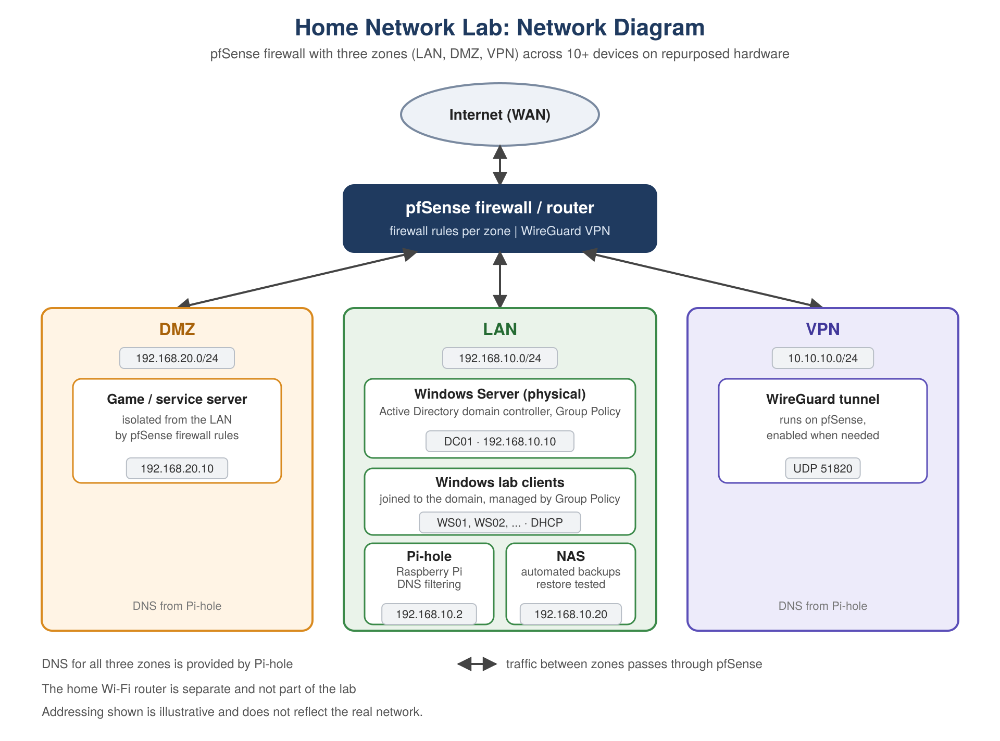

# Home Network Lab

A segmented home network built on repurposed hardware: a pfSense firewall with three zones (LAN, DMZ, VPN) across 10+ devices, a Windows Server Active Directory domain, Pi-hole DNS filtering and a NAS with automated backups.

Addressing in the diagram is illustrative and does not reflect the real network.

## Zones

| Zone | Example subnet | What is in it |
|------|----------------|---------------|
| LAN | 192.168.10.0/24 | Windows Server (physical) running Active Directory, Windows lab clients joined to the domain and managed with Group Policy, a Raspberry Pi running Pi-hole, and a NAS |
| DMZ | 192.168.20.0/24 | A game / service server, isolated from the LAN by pfSense firewall rules |
| VPN | 10.10.10.0/24 | WireGuard tunnel running on pfSense, enabled when needed |

## Notes

- The lab is its own network behind pfSense. The home Wi-Fi router is separate and not part of the lab.
- All traffic between zones passes through the pfSense firewall.
- Pi-hole provides DNS for all three zones.
- The NAS runs automated backups, and restores were tested.
- Active Directory work in the lab: user and group accounts, Group Policy, password resets, account lockouts and MFA.
- Troubleshooting example: traced a network-access failure to a misconfigured NAT rule by reviewing the pfSense rules, then corrected it.
